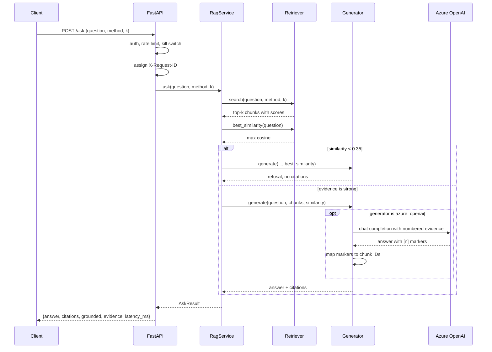

# Architecture

## Overview

One Docker image contains both the React frontend and the FastAPI backend. Azure
Container Apps runs it with `minReplicas=0`, so the app costs nothing while idle
and cold-starts on the first request.

```mermaid
flowchart TB
    subgraph Client
        B[Browser]
    end

    subgraph ACA[Azure Container Apps - Consumption, min=0 max=2]
        direction TB
        subgraph Container[Single container :8000]
            UI[React SPA<br/>web/dist]
            API[FastAPI<br/>/ask /search /feedback<br/>/healthz /readyz]
            SVC[RagService]
            RET[Retriever<br/>Local | AzureSearch]
            GEN[Generator<br/>Extractive | AzureOpenAI]
        end
    end

    subgraph Azure[Azure services]
        SRCH[(Azure AI Search<br/>Free tier<br/>3,600 chunks)]
        AOAI[Azure OpenAI<br/>text-embedding-3-small<br/>gpt-5-mini]
        AI[Application Insights]
        LA[Log Analytics<br/>1 GB/day cap]
    end

    subgraph External[Optional]
        LS[LangSmith]
    end

    B -->|HTTPS| API
    API --> UI
    API --> SVC
    SVC --> RET
    SVC --> GEN
    RET --> SRCH
    RET --> AOAI
    GEN --> AOAI
    API -.OTLP.-> AI
    AI --> LA
    API -.traces.-> LS
```

## Request flow for `/ask`



## Module responsibilities

| Module | Responsibility |
|---|---|
| `config.py` | All settings from environment variables. No secrets in code. |
| `corpus.py` | Load and validate the full corpus; build the evaluation set. |
| `text.py` | Tokenizer, sentence splitter, quoted-title extractor, token F1. |
| `bm25.py` | BM25 ranking, identical to the notebook. |
| `retrieval.py` | `Retriever` protocol, `LocalRetriever`, RRF, title anchoring. |
| `generation.py` | `Generator` protocol, `ExtractiveGenerator`, refusal logic. |
| `azure_openai.py` | Azure OpenAI embeddings and grounded chat generation. |
| `azure_search.py` | Index schema, idempotent indexing, `AzureSearchRetriever`. |
| `service.py` | `RagService` — the single entry point used by API, eval, and tests. |
| `api.py` | FastAPI app, endpoints, auth, rate limiting, correlation IDs. |
| `observability.py` | JSON logging, request IDs, optional LangSmith/OTel. |
| `evaluate.py` | Reproducible evaluation harness. |
| `index.py` | Idempotent indexing CLI. |

## Design decisions

### Dual retriever instead of replacing the notebook

Azure AI Search's Lucene BM25 differs from the notebook's hand-written BM25, so
swapping backends silently would change every reported metric. Keeping both
behind one protocol means the deployed system can be compared against the
baseline, and the local backend remains a working fallback if Azure is
unavailable.

### Extractive generator as the default

The notebook's extractive answerer needs no LLM, so it always works and costs
nothing. `GENERATOR_BACKEND=azure_openai` swaps in a grounded LLM answer. Both
share the same abstention rule, so their behaviour is comparable.

### 512-dimension embeddings

`text-embedding-3-small` supports a `dimensions` parameter. At 512 dims the
vector index is ~7.4 MB instead of ~22 MB at 1536 dims, which keeps the whole
index comfortably inside the Azure AI Search Free tier's 50 MB cap.

### Idempotent indexing

Documents are keyed by `chunk_id` and uploaded with `merge_or_upload`, so
re-running the indexer converges to the corpus contents instead of duplicating
rows. `corpus_fingerprint()` gives a stable hash for skipping redundant work.

### Cost controls as code

The Bicep template pins the search service to the Free tier, sets
`minReplicas=0`, caps Log Analytics ingestion at 1 GB/day, and creates budget
alerts at $25 and $40. Changing any of these requires editing the template, which
makes cost regressions visible in review.

## Security

- No credential is ever in source. Azure OpenAI and Azure AI Search use the
  container app's **system-assigned managed identity**; API keys are only a local
  development convenience.
- `/ask` and `/search` require `X-API-Key` when `API_KEY` is set.
- Per-IP rate limiting and a daily request cap bound abuse.
- `KILL_SWITCH=true` makes `/ask` and `/search` return 503 while leaving health
  probes working.
- The container runs as a non-root user (uid 10001).
- Kaggle data is excluded from Git by `.gitignore` and by a CI check.

### Current deployment: unauthenticated (temporary)

The shared demo runs with `API_KEY` **unset**, so the UI works without
credentials. This is deliberate and temporary:

- The auth code path is intact and activates as soon as `API_KEY` is set.
- No secret reaches the browser. Model and search access use managed identity,
  so removing the API key does not expose any Azure credential.
- Rate limiting, the daily cap, and budget alerts remain the abuse controls.
- To restore auth, set the `api-key` secret and `API_KEY=secretref:api-key`
  (see [`DEPLOYMENT.md`](DEPLOYMENT.md#unauthenticated-access-temporary)).
